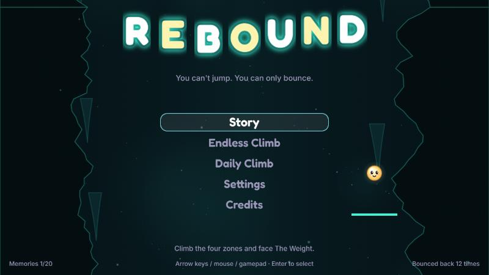
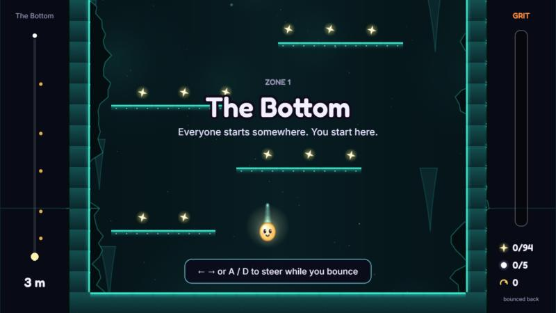
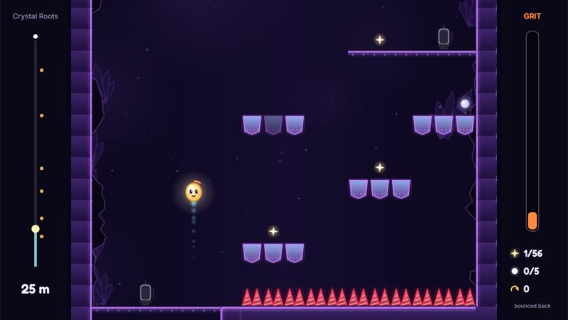
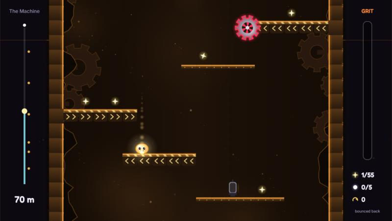
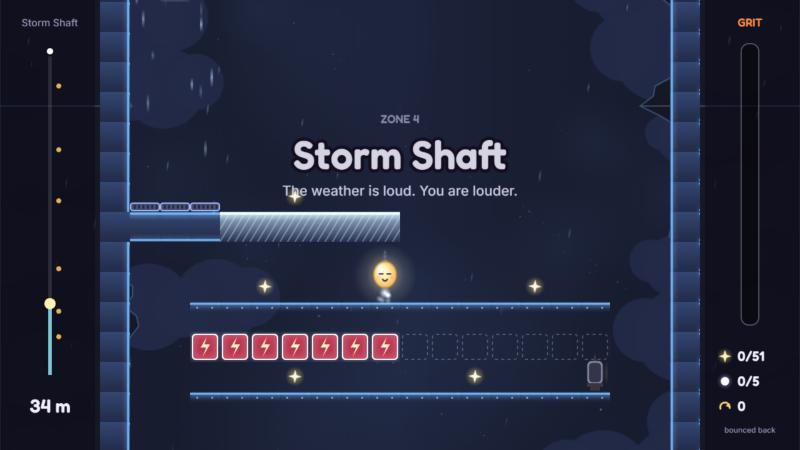
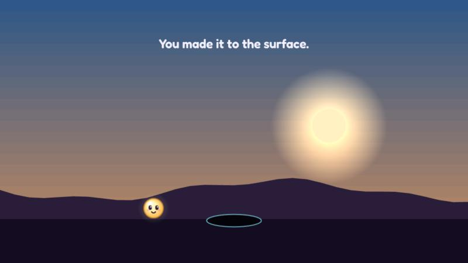

# REBOUND

> *You're a little rubber spirit who fell to the bottom of a deep well. You can't jump. You can only bounce. And every fall makes your next bounce stronger.*



REBOUND is a cozy-neon vertical climber made for the **"Bounce Back"** theme. Pip never stops bouncing. You steer in the air, squash at the right moment for bigger bounces, and turn every fall into **Grit**, which powers your comeback. Four zones, a final chase, an endless mode and a daily challenge, all in the browser. Every texture and every sound is generated in code.

| | |
|---|---|
|  |  |
|  |  |



## How it fits "Bounce Back"

- **Literally:** you never stop bouncing. Climbing means turning each landing into height.
- **Emotionally:** falling is never wasted. Height you lose becomes **Grit**, and a full meter unlocks a **Comeback**: slow motion, a huge launch, a rainbow trail and a musical swell. The death counter reads *"Times you bounced back"*. Twenty hidden **memories** offer short, warm lines about resilience.

## Controls

| Action | Keyboard | Gamepad | Touch |
|---|---|---|---|
| Steer | ← → or A / D | Left stick / D-pad | Drag on the left half |
| Squash | ↓ / S / Space (hold) | A / B / D-pad down | Hold the right half |
| Pause | Esc / P | Start | ❚❚ button (top left) |
| Menus | Arrows + Enter / Esc | D-pad + A / B | Tap |

Keyboard keys can be remapped in **Settings → Controls**.

### Mechanics
- **Auto-bounce:** Pip rebounds about 4 tiles every time it lands.
- **Squash:** press squash just before (or right as) you land for a **PERFECT**: +35% height, a flash and a "boing". Hold squash too long and you get a small, careful hop.
- **Grit:** every tile of height you *lose* fills the meter. Your next bounce gets stronger, then the meter drains.
- **Comeback:** when Grit is full, squash as you land to launch about 13 tiles in slow motion.
- **Pop & respawn:** hazards pop Pip. You respawn at the last **lantern**, keeping half your Grit.

### World
1. **The Bottom**: the tutorial. Bounce, steer, squash, Grit, Comeback.
2. **Crystal Roots**: crumbling crystal blocks and pinball bumpers.
3. **The Machine**: moving platforms, conveyor belts, sticky goo, spinning gears.
4. **Storm Shaft**: updrafts and crosswinds, ice, and lightning blocks that switch on and off.
5. **Finale: The Weight**: a dark mass rises from below and chases you to the surface.

### Modes
- **Story**: the four zones plus the finale, with zone select once a zone is reached.
- **Endless Climb**: 26 hand-made chunks stitched together by a seeded RNG, getting harder with height while The Weight rises behind you. Local top-10.
- **Daily Climb**: the same seed for everyone each UTC day. Your best score per day is saved.

### Accessibility & assists
Volume sliders, screen shake toggle, **reduced motion** (no flashes, slow-mo, zoom or shake), **high-contrast palette**, a wider perfect window, slower wind, optional infinite Grit, and key remapping. Hazards never rely on colour alone: spikes are striped, gears have hazard hubs, and lightning blocks carry a bolt icon. Lightning telegraphs blink at 2.5 Hz, under photosensitivity limits.

## Run it locally

You need [Node.js](https://nodejs.org) 22 or newer.

```bash
npm install
npm run dev        # open the printed localhost link
```

Other scripts:

```bash
npm test           # unit tests (grit maths, level parser, reachability of every level, endless stitching, saves)
npm run lint       # ESLint + Prettier check
npm run build      # production build into dist/
npm run preview    # serve the production build
npm run zip        # build first, then zip dist/ into release/rebound-web.zip for itch.io
```

## Publish

### GitHub Pages
1. Create an empty GitHub repository and push this folder to its `main` branch.
2. In the repo, open **Settings → Pages** and set **Source: GitHub Actions**.
3. The workflow in `.github/workflows/deploy.yml` lints, tests, builds with the correct base path (`/<repo-name>/`), and deploys. Your game appears at `https://<user>.github.io/<repo-name>/`.

### itch.io
1. `npm run build` then `npm run zip`.
2. On itch.io create a new project, set **Kind of project: HTML**, and upload `release/rebound-web.zip`.
3. Tick **"This file will be played in the browser"**. Set the viewport to 1280 × 720 and enable the fullscreen button.

## Tech

- [Phaser 3](https://phaser.io) (Arcade Physics), TypeScript (strict), [Vite](https://vitejs.dev)
- [Tone.js](https://tonejs.github.io): synthesized SFX and generative, adaptive music (pad, bass, arpeggio and percussion layers fade in as you climb)
- Vitest, ESLint and Prettier
- No backend and no network calls at runtime. It works offline once loaded.

### Project layout
```
src/
  main.ts            game config
  config/            tuning.ts (all physics/feel numbers), palette.ts (every colour)
  logic/             pure, unit-tested logic: grit, level parser, reachability, endless, rng, daily, high scores
  levels/            ASCII maps for each zone, the finale and the Endless chunks
  art/               procedural texture generators (Pip, tiles, objects, parallax)
  audio/             Tone.js SFX + music engine
  entities/          world builder, Pip, The Weight, effects
  scenes/            Boot, Preload, Title, Game, Endless, HUD, Pause, Settings, ZoneComplete, Ending, Credits
  input/             keyboard / gamepad / touch
  save/              versioned localStorage save
tests/               Vitest suites
scripts/             itch.io zip script, level authoring helpers
```

Level maps use a one-character legend (`#` rock, `_` one-way ledge, `^` spike, `L` lantern, `*` spark, `M` memory, `C` crumble, `B` bumper, `H`/`V` movers, `~ { }` wind, `z`/`x` lightning blocks…). It is documented at the top of `src/logic/levelParser.ts`. The tests check that every zone can be completed and that every lantern and memory can be reached.

## Credits & licenses

- Game code, procedural art and music: this project, [MIT License](LICENSE).
- **Phaser** (MIT) · **Tone.js** (MIT) · **Vite** (MIT) · **TypeScript** (Apache-2.0) · **Vitest** (MIT)
- **Fredoka** by Milena Brandão and **Inter** by Rasmus Andersson, both under the SIL Open Font License 1.1, bundled via `@fontsource`.
